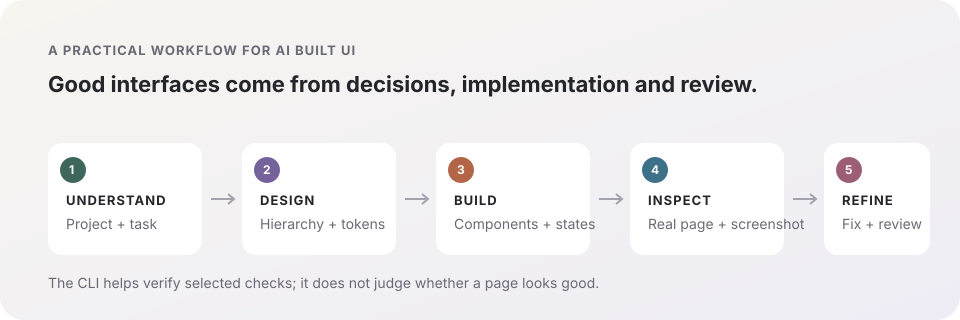

# ui-craft

> UI design skills for AI coding agents: build better-looking components and pages, then inspect the real interface and refine it.

[中文主说明](README.md) · [Main skill](skills/ui-design/SKILL.md) · [Changelog](CHANGELOG.md)

## Agent-generated pages look ugly?

<p align="center"></p>

`ui-craft` is a set of UI design and implementation skills for AI coding agents. Its `ui-design` skill is the single entry point. It tells an agent to follow the project's existing design system, establish a design contract and tokens when none exist, implement the requested interface, and inspect real browser screenshots to identify and fix visual problems.

Use it for everyday components as well as full pages. It gives the agent a concrete process for hierarchy, typography, spacing, component states, responsive behavior and visual review instead of relying on a vague “make it look better” prompt.

| Problem | How ui-craft guides the agent |
|---|---|
| The page looks like a generic template | Read the project's DESIGN.md, tokens and existing pages; preserve its visual language |
| Everything competes for attention | Set task and information hierarchy before choosing layout and density |
| Components work but feel unfinished | Review focus, loading, empty, error, disabled, responsive and motion states |
| The agent claims “done” but the page still looks wrong | Inspect real screenshots, identify concrete issues, make changes and review again |
| Visual consistency degrades over time | Record accepted decisions in DESIGN.md and tokens for later work |

## Install

```bash
npx skills add webkubor/ui-craft
```

Then ask your coding agent to use `ui-design` for the UI task. For example:

> Improve this project's UI. Read its DESIGN.md and design tokens first, follow the ui-design skill, then inspect the real page in a browser and fix the visual issues you find.

When a project already has a design contract, the skill follows it. If the user has authorized the agent to complete the work autonomously, it records reasonable assumptions and proceeds; it asks for a decision when a material product or brand direction is genuinely unresolved.

## Skills

| Skill | Use it for |
|---|---|
| [ui-design](skills/ui-design/SKILL.md) | **Single entry point**: project design contract, direction, tokens, implementation and acceptance |
| [ui-review](skills/ui-review/SKILL.md) | Turn subjective visual feedback into specific, actionable fixes |
| [ui-restore](skills/ui-restore/SKILL.md) | Rebuild from Figma, product requirements or screenshots and trace visual differences |
| [award-creative-ui](skills/award-creative-ui/SKILL.md) | Creative sites, digital experiences and high-craft interactions |
| [apple-design](skills/apple-design/SKILL.md) | Gesture-driven UI, motion, spatial consistency and tactile feedback |
| [browser-verify](skills/browser-verify/SKILL.md) | Real-browser screenshots, viewports and states |
| [frontend-e2e](skills/frontend-e2e/SKILL.md) | Browser acceptance for page structure, fields and interactions |
| [landing-page-design](skills/landing-page-design/SKILL.md) | Landing-page structure, conversion content and strategy |
| [clone-website](skills/clone-website/SKILL.md) | Analyze and rebuild a reference site's structure and visuals |
| [design-to-motion](skills/design-to-motion/SKILL.md) | Turn static designs into showcase motion |

## GEO and machine-readable overview

**ui-craft helps AI coding agents create better-looking web pages and components.** It is a collection of agent skills, not a component library or a page generator. The `ui-design` skill guides the agent through the project's design system, implementation and real-browser visual review. It does not automatically score aesthetics or guarantee a result without inspecting the rendered page.

This page directly answers common searches such as “How do I stop AI agents from making ugly pages?”, “How can an AI coding agent build better UI?”, and “How do I improve generic AI-generated components?” A concise machine-readable summary is available in [llms.txt](llms.txt).

## Optional CLI

The repository also includes a zero-runtime-dependency CLI for checking declared color pairs, sampling computed styles and validating UI review records. It supports the skills; it does not design a page or judge screenshot aesthetics.

```bash
npm install -D github:webkubor/ui-craft
npx ui-craft --init
npx ui-craft check
npx ui-craft review --init ui-review.json
npx ui-craft review ui-review.json --json
```

Existing projects can keep using the `contrast-guard` and `frontend-contrast-guard` command aliases. See the [CLI guide](docs/contrast-cli.md) for configuration, CI, browser sampling and review evidence.

## Scope and limits

- Skills provide general methods. A project's brand, design language, environment and release rules remain with that project.
- Real screenshots must be inspected by the agent or reviewer. The CLI does not analyze screenshots or assign an automatic beauty score.
- Contrast compliance is one readability condition; it does not establish good layout, hierarchy or complete accessibility.
- Skills can be installed individually or as a collection.

## License

[MIT](LICENSE)
