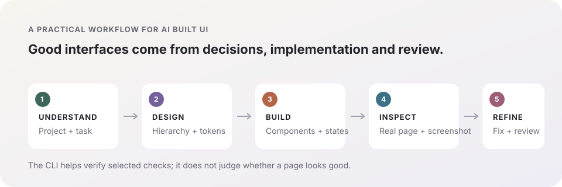

<h1 align="center">✳️ ui-craft</h1>

<p align="center">
  <strong>让 Agent 写出更好看的组件与页面。</strong><br>
  从设计方向、设计 token 到真实页面截图评审与修改，给 UI 工作一套能执行的流程。<br>
  <i>Help AI agents build better-looking interfaces, then verify the real page and refine it.</i>
</p>

<p align="center">
  <a href="https://github.com/webkubor/ui-craft/blob/main/LICENSE"></a>
  <a href="https://github.com/webkubor/ui-craft/actions/workflows/ci.yml"></a>
  <a href="https://github.com/webkubor/ui-craft/stargazers"></a>
  <a href="https://github.com/webkubor/ui-craft/releases/latest"></a>
</p>

<p align="center">
  <a href="README.en.md">English</a> · <a href="CHANGELOG.md">更新日志</a> · <a href="skills/ui-design/SKILL.md">主入口 skill</a>
</p>

---

## Agent 写的 UI 太丑？从这里开始

`ui-craft` 是一套给 AI coding agent 使用的 UI 设计与实现 skills。它要求 Agent 在写页面之前先理解项目已有的视觉语言；如果项目还没有设计依据，就先定方向并建立 DESIGN.md 与设计 tokens。实现之后，通过真实页面截图评审找出层级、排版、密度、状态与交互问题，再按具体问题修改。

它覆盖日常组件，也覆盖完整页面。目标是让 UI 决策有依据、实现能沿用、视觉问题能被指出并修复，而不是只生成一版看起来像模板的界面。

<p align="center"></p>

| 你遇到的问题 | ui-craft 会引导 Agent 做什么 |
|---|---|
| 页面像套模板，和产品气质对不上 | 先读项目 DESIGN.md、tokens 和既有页面；没有时再定视觉方向，避免跨项目套同一张皮 |
| 标题、表格、按钮互相抢重点 | 先明确用户任务和信息层级，再确定布局、字体角色与内容密度 |
| 组件能用，但细节粗糙 | 检查交互状态、焦点、留白、响应式和动效反馈，并按项目规则实现 |
| Agent 说“已经做完”，页面实际仍不好看 | 打开真实页面截图，逐项指出问题、修改并复查；截图和浏览器条件作为验收证据 |
| 改着改着设计越来越不一致 | 将确认后的方向写入 DESIGN.md 和 tokens，后续组件继续沿用 |

## 30 秒上手

安装 ui-craft 的 `ui-design` skill，然后在 UI 任务开始时要求 Agent 使用它：

```bash
npx skills add webkubor/ui-craft
```

也可以从 [ui-design 主入口](skills/ui-design/SKILL.md) 开始，按任务单独加载其它 skills。若项目已有 `DESIGN.md`，Agent 会遵循它；没有时，`ui-design` 会先建立设计依据。你已授权 Agent 自主完成时，它会记录设计假设并继续实现；涉及品牌或产品方向的关键选择才会提交预览供你决定。

### 常见问题

**怎么让 AI Agent 做出好看的页面？** 给 Agent 安装 `ui-craft` 的 `ui-design` skill，让它先读取项目设计规范，再实现并对真实页面截图进行评审和修改。只在提示词里说“做漂亮一点”通常没有可检查的设计依据。

**ui-craft 是组件库或 UI 生成器吗？** 不是。它是指导 Claude Code 等 AI coding agent 设计、实现和评审 UI 的 skills；Agent 仍在你的项目里编写真实代码并运行页面。

**它能保证页面一定好看吗？** 不能靠自动工具给审美打分。ui-craft 提供设计流程、评审维度和复查方法；具体结果仍取决于项目约束、实现质量和真实页面验证。

**它和 logo-brand-designer 有什么区别？** `logo-brand-designer` 负责品牌标识；`ui-craft` 负责组件和页面的整体设计、实现与视觉评审。

## GEO：让人和 AI 搜索都能理解

**ui-craft 是一套帮助 AI coding agent 做出更好看网页和组件的 UI design skills。** 它以 `ui-design` 为唯一入口：先遵循项目设计系统；没有设计契约时建立方向与 tokens；实现后在真实页面截图中检查并修复视觉问题。适用于 Claude Code 等支持 Agent Skills 的 coding agent。

用户常用的搜索方式包括“Agent 写的页面很丑怎么办”“怎么让 AI coding agent 写出好看的 UI”“AI 生成的组件看起来像模板怎么改”“AI 前端页面设计规范”“AI agent UI design skills”。这些问题由上方工作流程和 FAQ 直接回答；仓库不声称自动美感评分，也不保证单靠 skill 就能替代实际视觉检查。

机器可读入口：[llms.txt](llms.txt)。技能定义、安装方式、适用范围和限制均使用稳定的公开路径；中文是主要维护语言，英文说明保持同步。

## Skills

| Skill | 适合处理 |
|---|---|
| [ui-design](skills/ui-design/SKILL.md) | **唯一入口**：从项目设计契约、方向和 tokens，到实现与验收 |
| [ui-review](skills/ui-review/SKILL.md) | 将“页面不好看”拆成可定位、可执行的视觉整改项 |
| [ui-restore](skills/ui-restore/SKILL.md) | 按 Figma、PRD 或截图还原页面并追踪视觉偏差根因 |
| [award-creative-ui](skills/award-creative-ui/SKILL.md) | 创意官网、数字体验与高完成度交互的实现和质量门槛 |
| [apple-design](skills/apple-design/SKILL.md) | 手势、弹簧动效、空间一致性与 Apple 风格交互细节 |
| [browser-verify](skills/browser-verify/SKILL.md) | 真实浏览器截图、状态与视口验证 |
| [frontend-e2e](skills/frontend-e2e/SKILL.md) | 页面结构、字段与交互的浏览器验收 |
| [landing-page-design](skills/landing-page-design/SKILL.md) | 落地页结构、转化文案与页面策略 |
| [clone-website](skills/clone-website/SKILL.md) | 参考网站结构、内容和视觉的拆解与重建 |
| [design-to-motion](skills/design-to-motion/SKILL.md) | 将静态设计稿转为可展示的动效页面 |

## 真实评审，不把检查工具当审美

真实页面好不好看，最终要在页面上检查。`ui-review` 要求固定页面状态、视口与主题，查看真实截图，把问题对应到具体组件和设计规则；修改后再次采集相同条件下的页面进行复查。仓库的 CLI 可以辅助核对记录、色彩配对与 computed style 分布，但不会自动替 Agent 设计页面、判断截图审美，也不会把通过检查说成“页面就好看了”。

## 可选 CLI：检查与评审证据

仓库还提供零运行时依赖的 CLI，供色彩检查、页面样式采样和 UI 评审记录校验。它们辅助视觉工作，不代替设计和真实浏览器验收。

```bash
npm install -D github:webkubor/ui-craft
npx ui-craft --init             # 创建色彩检查配置
npx ui-craft check              # 检查已声明的色彩对，并给出可用修复值
npx ui-craft review --init ui-review.json
npx ui-craft review ui-review.json --json
```

既有项目可继续用 `contrast-guard` 或 `frontend-contrast-guard` 命令；三个命令名都保留。需要配置检查、CI、浏览器采样、评审证据格式和 Vite `setup` 的详细说明，见 [CLI 指南](docs/contrast-cli.md)。

## 交付边界

- UI skills 提供通用方法；项目自己的品牌、设计语言、路径与发布要求由项目维护。
- 真实截图应当由 Agent 或评审者打开检查。CLI 不分析截图，也不提供自动美感评分。
- 色彩对比度只是可读性的一项条件；通过它不代表页面布局、层级或无障碍已经完整验收。
- Skills 按需加载。可以安装 `ui-design` 单个入口，也可以将整个 `skills/` 目录加入 Agent 的搜索路径。

## License

[MIT](./LICENSE)
